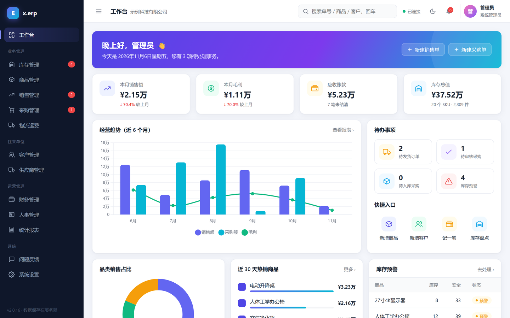
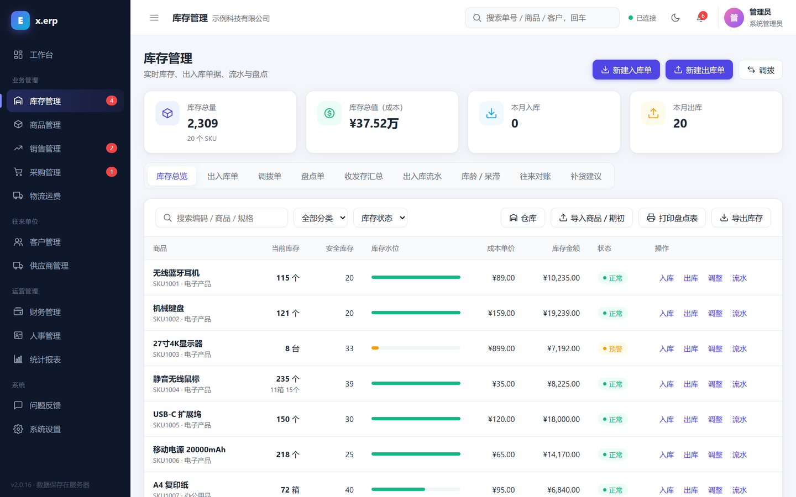
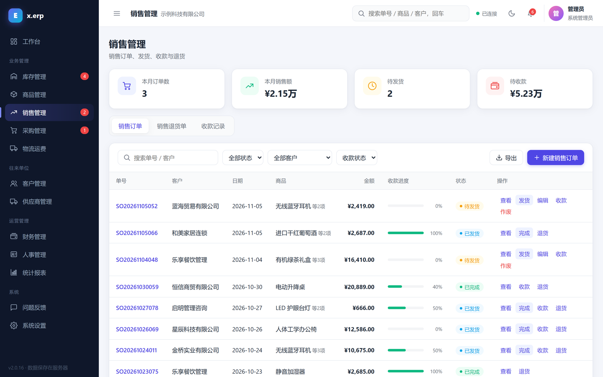

# x.erp

[](LICENSE)
[](https://github.com/Zyc009234/x.erp/releases/latest)

轻量级企业资源计划（ERP）系统，面向中小企业，可部署在 **飞牛 fnOS NAS**、**Docker**（群晖、威联通等任意 NAS）或任意装有 Node.js 22+ 的机器上，通过浏览器多人同时使用。进销存、财务、人事一站搞定，全部免费，完全离线可用，数据留在你自己手里。

- **在线演示**：<https://demo.zhaoyoucai.xyz>（账号 `admin`，密码 `admin123`；所有人共用，数据每小时重置）
- **官网与下载**：<https://www.zhaoyoucai.xyz/xerp/>（飞牛 fpk / Windows 安装包 / 安卓客户端）

| 工作台 | 库存 | 销售 |
|---|---|---|
|  |  |  |

## 功能

- 商品（编码、规格型号、安全库存）、库存（出入库流水、安全库存预警）
- 入库单 / 出库单：多行明细、扫码枪录入、作废冲回；A4 / 二等分（针式）/ A5 打印，带金额大写与签字栏
- 出入库审核（可选，系统设置里按入库 / 出库分别开启）：新单先「待审核」，审核通过才改库存；驳回需填原因，制单人可一键重开
- 多单位：商品可设辅助单位（如 1 箱 = 12 个，可带箱条码），入库、出库、调拨、销售、采购都能按箱录入，库存与成本仍按基本单位核算
- 打印模板（系统设置 → 打印模板）：各类单据可改标题（如「送货单」）、抬头地址电话、表头项目、明细列的显示 / 顺序 / 列名、签字栏、底部说明和字号，带实时预览
- 盘点单：建单时快照账面，扫码定位录入实盘数，审核后自动生成盘盈 / 盘亏；录入与审核权限分离；打印盘点表 / 盘点盈亏表
- 收发存汇总表：任意期间的期初、入库、出库、期末数量与金额，可打印、导出；点开商品查看明细账（逐笔结存）
- 成本核算：移动加权平均，入库自动重算单位成本，出库按当时成本计价
- Excel / CSV 导入商品和期初库存：下载模板 → 填写 → 预览校验 → 导入，任何一行出错都不会写入
- 销售单、采购单（审核 / 发货 / 入库 / 收付款）
- 客户、供应商往来与应收应付
- 财务收支流水、人事档案、经营报表
- 角色权限：预置仓库主管、仓管员、入库员、出库员、盘点员、商品专员、成本会计、只读查询、业务员，可新增自定义角色并逐项勾选权限（服务端校验）
- 功能模块可按需启用（默认只启用库存管理与商品管理，在 系统设置 → 常规设置 中开启其他模块）
- 操作日志
- 多仓库 + 调拨单：多个仓库 / 门店分开记库存，出入库单、盘点单、销售发货、采购入库按仓库进行，仓库之间开调拨单；收发存汇总与明细账可按仓库统计
- 批次 / 保质期：按商品开启；入库记批号、生产日期、有效期（可按保质期天数自动计算），出库先到期先出（已过期批次不会自动发出，报损出库优先出过期批次），临期 / 过期提醒，批次随调拨走
- 条码标签打印：Code 128 条码，40×30 / 50×30 / 60×40 热敏标签或 A4 不干胶，可带品名、规格、售价
- 补货建议：按近期出库速度、到货周期、备货天数、安全库存与在途采购计算建议补货量，按供应商一键生成采购单
- 序列号：按商品开启，出入库单、调拨单逐件登记（可扫码，出库可自动选号），查每一件的入库、出库、去向
- 往来对账单：按往来单位和期间列出收发货明细，销售 / 采购模块启用时带应收应付余额，可打印给对方盖章
- 库龄 / 呆滞品分析：按先进先出估算库龄分段，标出多少天没出库的呆滞品和占压金额
- 库存提醒推送：每天定时把库存不足、临期 / 过期批次、待审核单据发到企业微信、钉钉、飞书群机器人或任意 Webhook
- 盘点可按「2箱3」录入，开启「扫码累加」后每扫一次 +1（安卓客户端连续扫码）
- 数据存于本地 SQLite，每日自动备份（保留 30 天），支持 JSON 备份导出 / 导入

全部功能免费使用，基于 [AGPL-3.0](LICENSE) 协议开源。

## 目录

| 路径 | 说明 |
|---|---|
| `src/server.js` | 服务端：只依赖 Node.js 内置模块，数据库使用内置 `node:sqlite` |
| `src/index.html` | 前端单页应用（由服务端提供） |
| `src/client.js` | Windows 桌面客户端外壳（基于系统 Edge 内核的独立窗口） |
| `tests/` | 后端接口测试（`node --test tests/api.test.mjs`） |
| `fnos/` | 飞牛 fnOS 应用打包（manifest、生命周期脚本、安装向导） |
| `Dockerfile`、`docker-compose.yml` | Docker 镜像（见下方「Docker 部署」） |

## 直接运行

需要 Node.js 22.13+（22.5–22.12 需加 `--experimental-sqlite`）：

```bash
node src/server.js --data ./data --port 8686
```

浏览器打开 `http://127.0.0.1:8686`，默认账号 `admin` / `admin123`，首次登录后请立即修改。

## Docker 部署（群晖 / 威联通 / Unraid / 绿联 / 极空间等）

镜像 `ghcr.io/zyc009234/xerp`，Docker Hub 上同步一份 `zyc009234xerp/xerp`（群晖 Container Manager、威联通 Container Station、绿联、极空间的镜像仓库里搜 `xerp` 就能找到），支持 amd64 和 arm64。数据全部在容器的 `/data` 目录（数据库、每日自动备份、日志），挂载出来后升级镜像不丢数据。

```bash
docker run -d --name xerp --restart unless-stopped \
  -p 8686:8686 -v ./xerp-data:/data \
  -e XERP_ADMIN_PASSWORD=你的初始密码 \
  ghcr.io/zyc009234/xerp:latest
```

或者用仓库里的 [`docker-compose.yml`](docker-compose.yml)：`docker compose up -d`。浏览器打开 `http://NAS地址:8686`，账号 `admin`，密码是 `XERP_ADMIN_PASSWORD`（不设置则为 `admin123`，登录后请及时修改；这个变量只在第一次启动时生效）。

- **升级**：`docker pull ghcr.io/zyc009234/xerp:latest` 后重建容器（compose：`docker compose pull && docker compose up -d`）
- **国内拉不动 ghcr.io**：到 [Releases](https://github.com/Zyc009234/x.erp/releases/latest) 或官网下载离线镜像包 `xerp-<版本>-docker-amd64.tar.gz`（ARM 设备用 `arm64`），执行 `docker load -i xerp-<版本>-docker-amd64.tar.gz` 导入，之后同上
- **环境变量**：`XERP_ADMIN_PASSWORD` 首次启动的管理员密码；`XERP_STATS_URL=`（留空）关闭匿名使用统计，也可以在 系统设置 里关；`TZ` 默认 `Asia/Shanghai`
- **Unraid**：Docker 页面底部的 Template Repositories 里加上 `https://github.com/Zyc009234/x.erp` 并保存，然后 Add Container → Template 选 x.erp；模板见 [`unraid/xerp.xml`](unraid/xerp.xml)
- **CasaOS / ZimaOS**：已提交到官方应用商店，上架后在应用商店搜索 x.erp 即可安装
- 镜像由 [GitHub Actions](.github/workflows/docker.yml) 在每次发版时自动构建

## 测试

`tests/` 下是后端接口测试：在临时目录启动一个真实服务端，覆盖出入库、成本、多单位、盘点、出入库审核与权限。发版前跑一遍：

```bash
node --test tests/api.test.mjs
```

在线演示模式另有测试：`node --test tests/demo.test.mjs`。

## 在线演示模式

设置环境变量 `XERP_DEMO=1` 启动即为公开演示版：默认打开全部模块，登录页给出演示账号，顶部常驻提示条；屏蔽改密码、账号和角色管理、推送、快递鸟、导入备份 / 清空、问题反馈。部署在本机反向代理后面时按 `X-Forwarded-For` 区分访客。数据重置交给部署侧，见 `tools/demo-server/xerp-demo.service`（每小时重启并清空数据目录）。

## Windows 安装版

从 [Releases](https://github.com/Zyc009234/x.erp/releases) 下载 `xerp-<版本>-windows-x64-setup.exe`（Windows 10 / 11 64 位），双击安装：

- 安装向导里设置端口（默认 8686）和管理员密码；自带 Node.js，不用另装任何东西
- 以后台服务运行（任务计划程序「x.erp」，SYSTEM 身份开机自启，崩溃自动重启），不用登录 Windows
- 自动在防火墙放行该端口，仅限同一局域网；局域网其他电脑访问 `http://本机IP:8686`
- 数据在 `C:\ProgramData\XERP`；覆盖安装新版即可升级，升级和卸载都不删数据

构建：`powershell -ExecutionPolicy Bypass -File windows\build-windows.ps1`（需要 x64 Node.js 22.13+ 和 Inno Setup 6：`winget install JRSoftware.InnoSetup`），产物为 `dist\xerp-<版本>-windows-x64-setup.exe`。

## 安卓客户端

下载 `xerp-<版本>-android.apk`（Android 7.0 及以上）安装。手机连上和服务端同一个 Wi-Fi，首次打开填写服务端地址，或点「自动查找」扫描局域网。

- 右下角扫码按钮：用摄像头扫商品条码 / 二维码（EAN-13/8、UPC、Code 128/39/93、ITF、Codabar、QR、Data Matrix），结果填进当前输入框并自动回车，开出入库单、盘点、搜索都能用；没有选中输入框时直接查这个商品的库存
- 导出的 CSV / 备份 / 导入模板会让你选择保存位置；导入时可从手机选文件；单据、标签可走手机的系统打印（打印机或另存 PDF）
- 返回键先关弹窗，再后退；设置页和登录页可以切换服务器

页面本身来自服务端，服务端升级后手机端界面自动更新，一般不用重装 App。

构建（不需要 Gradle / Android Studio）：`powershell -ExecutionPolicy Bypass -File android\build-android.ps1`，需要 JDK 17+ 和 Android SDK（`platforms;android-36`、`build-tools;36.1.0`）。签名密钥首次构建时生成在 `%USERPROFILE%\.xerp-android\`，请备份——换了密钥就不能覆盖安装升级。

## 离线使用

完全离线可用：服务端只用 Node.js 内置模块和内置 SQLite，前端用到的图表（Chart.js）和 Excel 导入（SheetJS）组件放在 `src/vendor/` 随程序发布。

## 飞牛 fnOS 应用

构建（Windows，需 Node.js；首次运行会自动下载官方 [fnpack](https://developer.fnnas.com/docs/cli/fnpack/)）：

```powershell
powershell -ExecutionPolicy Bypass -File fnos\build-fnos.ps1
```

产物为 `dist\xerp-<版本>.fpk`，在飞牛 Web 界面 → 应用中心 → 手动安装。

- 依赖飞牛官方运行环境 `nodejs_v22`（安装时自动安装），包本身为纯 JS，x86 / ARM 通用
- 安装向导中设置管理员密码
- 数据目录为应用数据目录（`/vol*/@appdata/xerp`），升级不丢失
- `fnos/fix-fpk.js` 用于修正 Windows 上 fnpack 打包后的文件权限与换行

发布新版本时修改 `fnos/pkg/manifest` 中的 `version` 与 `changelog`。

### 上架飞牛应用中心

参见 [官方上架文档](https://developer.fnnas.com/docs/quick-started/publish-application/)：目前通过飞牛官网的微信群联系社区主理人，加入“应用中心开发者先锋交流群”后提交 `.fpk`、图标、真实界面截图与测试材料。

## 许可证

Copyright (C) 2026 Zyc009234

x.erp 以 [GNU Affero General Public License v3.0](LICENSE)（AGPL-3.0）发布：

- 个人、企业都可以免费使用，包括商用，可以自由修改
- 如果分发修改后的版本，或者把修改后的版本做成在线服务给别人用，必须以同样的 AGPL-3.0 协议公开修改后的完整源码，并保留原作者的版权声明
- 软件按“现状”提供，不附带任何担保

如需不受 AGPL 约束的商业授权，请通过 [官网留言](https://www.zhaoyoucai.xyz/xerp/) 联系作者。
